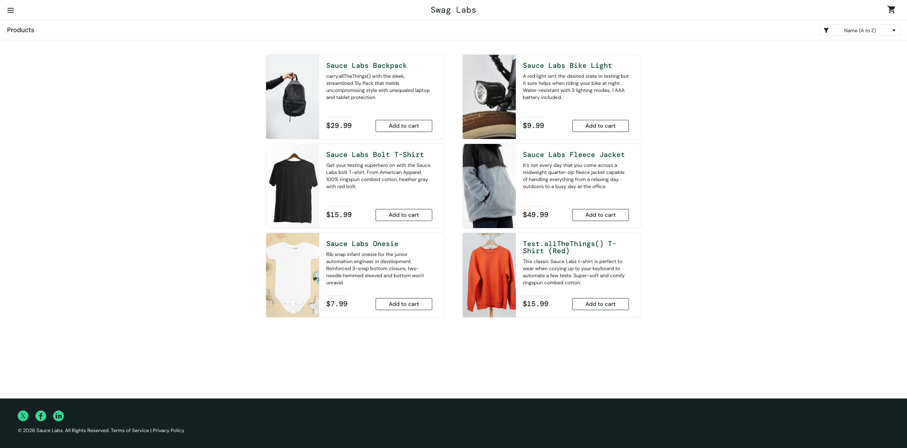

# BUG-001 — problem_user sees the same unrelated image for every product

- **Status:** Reproduced on 2026-11-18
- **Severity:** Medium
- **Priority:** P2
- **Area:** Inventory / product presentation
- **Environment:** https://www.saucedemo.com/, Chrome 157, macOS, headless Selenium run
- **Account:** `problem_user` / `secret_sauce`

## Steps to reproduce

1. Sign in as `standard_user` / `secret_sauce` and record the six inventory image URLs.
2. Sign out, sign in as `problem_user` / `secret_sauce`, and inspect the six product cards.
3. Compare the image source for each product with the standard-user baseline.

## Expected result

Each product card shows the image belonging to that product, as it does for `standard_user`.

## Actual result

All six product cards show the same bulldog image. The first image URL is `/assets/sl-404-Cq1a9k9X.jpg`; the standard-user Backpack image is `/assets/sauce-backpack-1200x1500-CjRW-Djj.jpg`. The automated comparison failed on the first product and the screenshot shows the repeated dog image.

## Reproduction check

`ProblemUserExplorationTests.problemUserProductImagesMatchBaseline`
