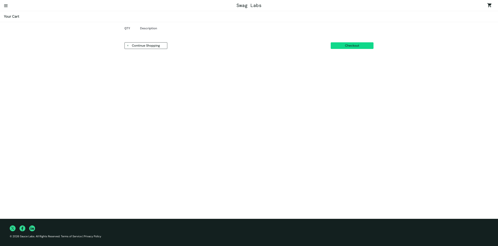

# BUG-003: Application Allows Checkout With an Empty Cart

## Status
Confirmed — Reproduced

## Severity
Medium

## Priority
High

## Environment
- Application: https://www.saucedemo.com/
- Browser: Google Chrome 157
- Automation: Java, Selenium 4.52.0, TestNG
- Test User: standard_user

## Preconditions
- User is logged in as standard_user.
- Shopping cart contains zero products.

## Steps to Reproduce
1. Open https://www.saucedemo.com/.
2. Log in using standard_user / secret_sauce.
3. Do not add any products to the cart.
4. Open the shopping cart.
5. Verify that the cart contains zero items.
6. Click Checkout.
7. Enter First Name, Last Name, and Postal Code.
8. Click Continue.
9. Click Finish.

## Expected Result
The application should prevent checkout completion when the shopping cart is empty and display an appropriate validation message.

## Actual Result
The application allows the checkout process to finish and displays the "Checkout: Complete!" confirmation page despite the cart containing zero products.

## Evidence

## Automation
Test class: ProblemUserExplorationTests

Test method: emptyCartCannotCompleteCheckout

The automated test fails at the final assertion because the application reaches the checkout-complete page.

## Reproducibility
Successfully reproduced using an isolated TestNG suite.
